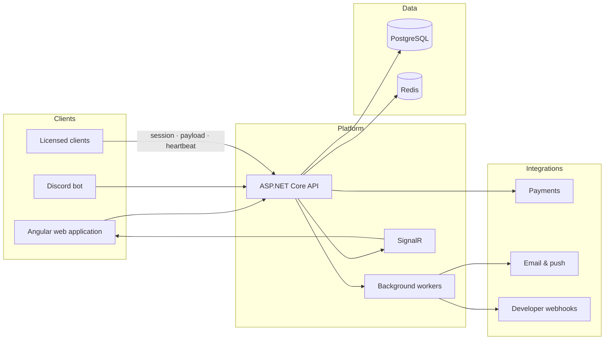
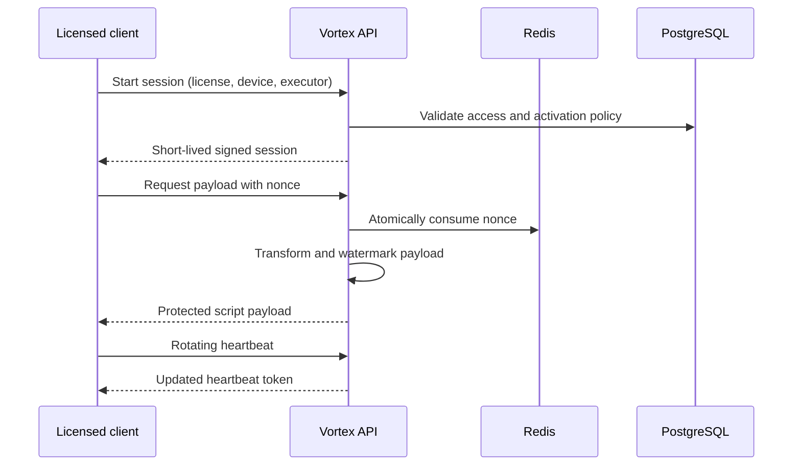

# Vortex

### Licensing, secure delivery, and operations for script developers

Vortex brings protected script delivery, license management, developer analytics,
buyer self-service, and Discord automation together in one production-oriented platform.

[Live platform](https://vortexlicensing.com)

---

## The platform

Vortex is a full-stack platform for developers who distribute licensed scripts.
It manages the complete lifecycle: publishing a product, issuing access, securely
delivering each payload, observing runtime activity, and supporting buyers.

| | Capability | What it provides |
|---|---|---|
| **01** | Secure delivery | Short-lived signed sessions, single-use nonces, device limits, executor rules, and per-request payload watermarking |
| **02** | License operations | Key creation, bulk actions, expiry, HWID/IP controls, activations, bans, reseller access, and audit history |
| **03** | Developer control plane | Live metrics, logs, alerts, incidents, status pages, webhooks, organization access, and billing |
| **04** | Buyer experience | Public marketplace, license portal, Discord verification, renewals, downloads, and support |

## How it fits together

The API is the system of record. The web application and Discord bot share its
authorization, licensing, support, and organization model, while Redis keeps
latency-sensitive loader and realtime paths away from unnecessary database work.

## Secure loader flow

Protected delivery is the core of Vortex. A loader receives content only after a
three-stage handshake:

- License, device, IP, executor, expiry, and ban policies are enforced before delivery.
- Payload nonces are consumed atomically and fail closed.
- Every delivered payload can carry a key-specific anti-leak watermark.
- Hot-path state is cached with bounded fallbacks and explicit invalidation.
- Activations, metrics, loader events, and usage counters are buffered and flushed
  in batches to reduce write amplification.

## Product surfaces

### Developer dashboard

The Angular application includes a public product site and an authenticated control
plane. Developers can manage scripts and releases, issue license keys, inspect
activations, analyze custom metrics, configure alerts, publish marketplace listings,
manage organizations, and operate customer support from one interface.

It uses standalone OnPush components, signals, guarded role-specific routes, SignalR
updates, installable service-worker support, and responsive data visualizations.

### Discord automation

The .NET Discord bot turns common support and licensing tasks into self-service flows:

- License redemption, renewal, transfer, unlinking, and HWID resets
- Buyer verification and automatic license-role synchronization
- Persistent developer, licensing, verification, and support panels
- Support threads connected to the Vortex support workflow
- Developer-managed giveaways and server configuration
- Expiry reminders, claim expiry, reconciliation, and audit logging

### API and operations

The ASP.NET Core API provides the shared platform behind both clients:

- Identity, JWT authentication, TOTP two-factor authentication, and scoped API keys
- Script releases, encrypted source storage, backups, loader delivery, and metrics
- Organizations, fine-grained permissions, reseller workflows, and audit events
- Stripe and cryptocurrency checkout workflows with idempotent event processing
- Alerts, escalation policies, maintenance windows, incidents, and public status pages
- Signed webhooks, SSRF-resistant URL validation, web push, email, and SignalR
- Health, readiness, runtime telemetry, retention jobs, and anomaly detection

## Engineering highlights

| Area | Implementation |
|---|---|
| **Backend** | .NET 10, ASP.NET Core, EF Core, PostgreSQL, Redis, Identity, SignalR |
| **Frontend** | Angular 21, TypeScript, standalone components, signals, Tailwind CSS, ApexCharts |
| **Automation** | .NET worker service and Discord.Net interaction modules |
| **Observability** | OpenTelemetry, Prometheus metrics, health probes, structured operational events |
| **Quality** | API and bot test suites, Vitest, Playwright, BenchmarkDotNet, loader stress scenarios |
| **Delivery** | Docker images, schema migrator, reverse proxy, health-gated deployment, encrypted backups |

Particular attention is given to concurrency, bounded memory use, failure recovery,
least-privilege access, webhook safety, cache invalidation, and keeping the public
loader path predictable under load.

## Public and private systems

This showcase covers the public-facing Vortex platform: its API, web application,
and Discord bot. The platform is presented here at an architectural and product
level; its production source code remains private.

Vortex also operates a separate private API and frontend on an independently managed
VPS. That system supports internal workflows and is isolated from the public platform
at both the source and deployment levels. Its implementation and infrastructure
details are intentionally not published.

## Security approach

Security is handled as a system property rather than a single feature. The platform
uses short-lived credentials, scoped access, audited privileged actions, secret
rotation paths, strict redirect and webhook validation, sanitized rich content,
rate-limited public endpoints, and explicit degraded-readiness reporting.

Sensitive infrastructure values, production configuration, signing material, and
private operational documentation are not stored in this showcase repository.

## Project status

Vortex is an actively developed, deployed system. This repository presents the
architecture and engineering work without redistributing private configuration,
customer information, or protected infrastructure details.

---

Built across backend engineering, frontend product design, automation, security,
observability, and infrastructure.

[Explore Vortex](https://vortexlicensing.com)

