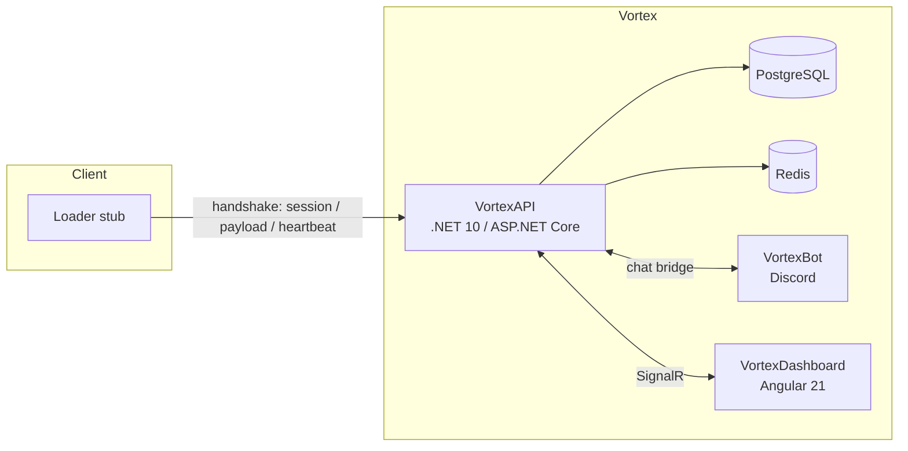

# Vortex

**Software licensing & loader platform** - HWID/IP locking, anti-leak payload delivery, and a real-time operator dashboard.

Source is private - Vortex is a commercial product. This repository is a showcase.

---

## What it is

Developers sell access to their software via license keys. A buyer runs a small loader stub, which authenticates against Vortex - HWID/IP lock, device caps, environment allow/deny, ban checks - and then receives a per-request **watermarked** payload. Developers manage everything (keys, devices, billing, alerts) from a real-time dashboard.

## Screenshots

| Overview cockpit | Instances |
|---|---|
|  |  |
| **Metrics** | **Admin** |
|  |  |

## Architecture

| Project | Stack |
|---|---|
| `VortexAPI` | .NET 10, ASP.NET Core Identity + JWT, EF Core + PostgreSQL, Redis, SignalR, Resend |
| `VortexDashboard` | Angular 21 standalone + signals, Tailwind v4, ApexCharts, Vitest |
| `VortexBot` | .NET Discord bot - two-way site/Discord chat bridge |

## The interesting engineering

**Three-step loader handshake.** The whole product hinges on this flow being both fast and abuse-resistant:

1. **Bootstrap** - buyer sends an environment fingerprint + HWID + IP, gets a short-lived HMAC-signed session token. Device cap enforced with a unique `(LicenseKeyId, HwidHash)` index inside a transaction; IP/HWID bans and environment rules checked here.
2. **Payload** - session token + nonce. The nonce is consumed atomically in Redis (**fail-closed** if Redis is down), then the payload is returned with a **per-request watermark** (key ID embedded) for leak tracing.
3. **Heartbeat** - periodic keep-alive that rechecks the session IP and **rotates the token every beat**.

**Security hardening shipped:**

- Nonce replay TOCTOU fixed via Redis atomic `SET NX`, fail-closed.
- Rate-limit TOCTOU fixed with an atomic/locked increment consistent across Redis + MemoryCache.
- License-check **timing side-channel** removed - every branch does equivalent work.
- Device-cap activation race fixed (unique index + transaction).
- Stripe webhook **idempotency** table dedups on event ID.
- Loader session secret separated from the JWT secret; the app fails fast at startup if it is missing.

## Features

- **Auth** - email/password, 2FA, email verification, password reset.
- **Keys & devices** - license lifecycle (Active/Paused/Banned/Expired), device caps, HWID/IP lock modes (None/Soft/Hard).
- **Real-time** - SignalR live updates, command palette, in-app notifications, offline alerting + alert rules.
- **Integrations** - API keys, HMAC-signed webhooks, Discord two-way chat bridge.
- **Billing** - Stripe (Basic / Pro / Studio / Enterprise), checkout + customer portal.
- **Buyer self-serve** - device list, self HWID reset with developer-set cooldown, copy-ready loader snippet.
- **Ops** - admin panel, public status pages, audit log.

